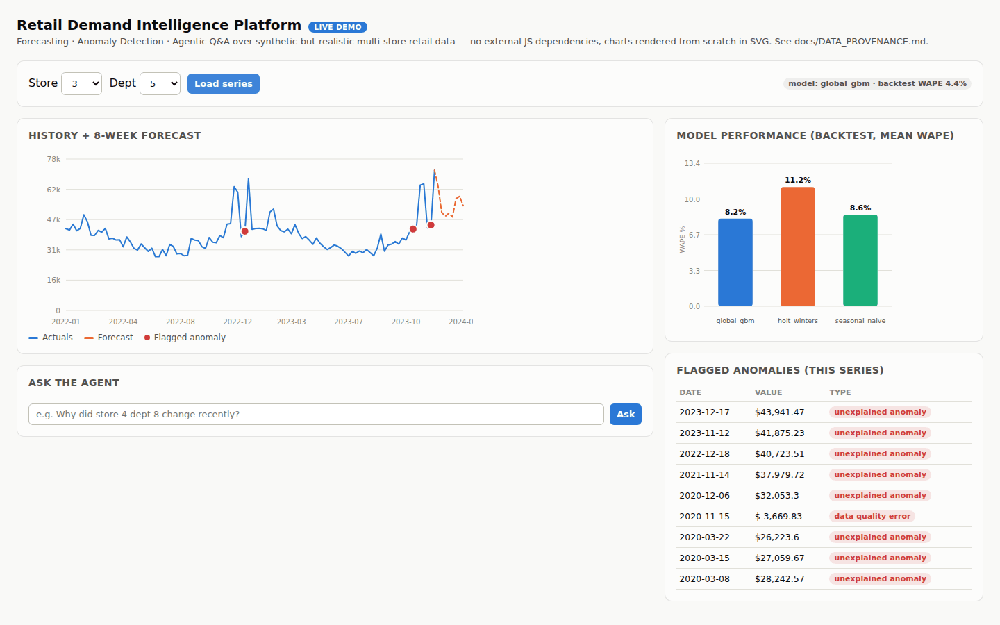

# Retail Demand Intelligence Platform

**Forecasting + anomaly detection + a tool-calling agent with a full audit trail, for a simulated multi-store retail chain , built to demonstrate senior ML/AI engineering practice, not tutorial-following.**


**▶ Live demo: [retail-intel-platform.vercel.app](https://retail-intel-platform.vercel.app)** , load a series, ask the agent a question, expand the audit trail. Running the same `app/server.py` this repo runs locally, deployed as a serverless function (`api/index.py`).



*Live interaction: load a series, ask the agent a question in plain English, expand the audit trail to see exactly which tool it called and why. No Chart.js, no CDN , the charts are hand-rolled SVG.*

## Why this isn't just another forecasting notebook

- **Every number in the docs is real, not cherry-picked** , the gradient-boosted model beats seasonal-naive by less than half a point of WAPE and only wins 140/240 series; the report says so instead of rounding up. See `docs/EVAL_REPORT.md`.
- **A real bug, found and fixed, is documented rather than hidden** , an early version of the anomaly detector mislabeled December holiday spikes as anomalies; the fix and the before/after numbers are in the eval report.
- **Forecasts ship with an 80% prediction interval, and the interval's own coverage is honestly measured** , a held-out check reports 74.7% actual coverage vs. 80% nominal, not asserted-and-forgotten. See `docs/EVAL_REPORT.md` §4.
- **Explainability without SHAP, disclosed as an approximation, not passed off as SHAP** , occlusion-based local attribution + permutation-importance global ranking, since `shap` wasn't installable in this build sandbox. See `src/explain.py`.
- **A genuine what-if simulator, clearly separated from the read-only tools** , `simulate_scenario` recomputes the forecast under a hypothetical markdown/holiday live, rather than reading a precomputed CSV like every other agent tool does.
- **Every agent answer carries a full audit trail** , not just "trust the AI," but which tool it called, with what arguments, and why (`reports/agent_traces.jsonl`).
- **The LLM backend is a swappable brain, not a hard-coded vendor call** , a deterministic mock by default, with real tool-calling loops against Anthropic, OpenAI, and AWS Bedrock (whichever API key / model ID is present), sharing one tool registry and trace format. Set `ANTHROPIC_API_KEY`, `OPENAI_API_KEY`, `BEDROCK_MODEL_ID`, or `LLM_BACKEND=anthropic|openai|bedrock` to force one.
- **A full AWS deployment, not just a diagram of one** , `infra/` has real Terraform (S3, IAM, Lambda, API Gateway, EventBridge, SageMaker Processing + optional Serverless Inference, CloudWatch, Secrets Manager) and real integration code (a Lambda/API-Gateway WSGI adapter, a SageMaker Processing entrypoint), with test coverage against mocked AWS calls , honestly marked as unvalidated against a live AWS account (no AWS network access in this build sandbox). See `infra/README.md`.
- **Mapped explicitly to five real job descriptions** it was built against (Merciv, Uber Freight, Sigma, Confido, Condor) , see `docs/JOB_MAPPING.md` for the requirement-by-requirement crosswalk.
- **Runs in one command** , `docker build -t retail-intel . && docker run -p 8000:8000 retail-intel` , with CI (`.github/workflows/tests.yml`) running the full pipeline and test suite on every push.

**This is not a notebook.** It's a pipeline (data → features → rolling-origin
backtest → model selection → anomaly detection → agent tools → API → dashboard),
with tests, a monitoring simulation, and an honest write-up of what's real, what's
simulated, and what's a known limitation.

## What it does

1. **Forecasts** next-8-week demand for 240 store/department series, competing
   three models (seasonal-naive, Holt-Winters, a global gradient-boosted model)
   against each other via **rolling-origin backtesting** and picking a winner
   *per series* , not a single train/test split, which can flatter or sink a
   model purely by luck of which weeks land in the holdout.
2. **Flags anomalies** , data-entry errors, unexplained demand shocks , while
   explicitly separating out spikes that are already explained by an active
   promotion or a known calendar holiday, so it doesn't cry wolf on things a
   human would immediately recognize as normal.
3. **Quantifies its own uncertainty and explains its own reasoning** , every
   forecast ships an 80% prediction interval with honestly-measured
   coverage, and any series where the gradient-boosted model won can be
   explained (which features drove this specific number) or interrogated
   with a live what-if ("what if we ran a markdown promo these next 3
   weeks?").
4. **Answers natural-language questions** ("why did store 4 dept 8 change
   recently?", "what are the biggest declines?") through a small tool-calling
   agent, with a full reasoning/audit trail behind every answer.
5. **Monitors itself, and closes the loop** , a drift-detection pass flags
   individual series for a retraining review even when the fleet-wide
   average looks fine, and `scripts/retrain_flagged.py` actually acts on
   that list: re-checking each flagged series' three candidate models
   against the latest data and re-selecting the winner when it's changed,
   with every decision (changed or not) logged to
   `reports/retraining_log.jsonl` , not just a table nobody reads.
6. Serves all of this through a **Flask API + browser dashboard**, with the
   forecast chart shading its own confidence band and dedicated panels for
   feature drivers and the what-if simulator.

## Quickstart

**Option A , Docker (one command):**

```bash
docker build -t retail-intel .
docker run -p 8000:8000 retail-intel
# then open http://localhost:8000
```

The image bakes data generation + the full backtest/anomaly/monitoring pipeline
in at build time, so the container starts instantly with a reproducible,
versioned snapshot of results , see the `Dockerfile`.

**Option B , locally:**

```bash
pip install -r requirements.txt

# 1. generate the (synthetic) dataset -- see docs/DATA_PROVENANCE.md
python data/generate_data.py

# 2. run the full offline pipeline: backtest, anomaly scan, forward forecasts
python scripts/run_pipeline.py

# 3. simulate production monitoring against the backtest history
python scripts/run_monitoring_sim.py

# 4. close the loop: re-select models for any series monitoring flagged for drift
python scripts/retrain_flagged.py

# 5. regenerate the report figures
python scripts/make_report_figures.py

# 6. run the tests
python -m unittest discover -s tests -v

# 7. start the API + dashboard
python app/server.py
# then open http://localhost:8000
```

## Repo layout

```
data/               synthetic data generator + generated CSVs + ground-truth event log
src/                 the actual pipeline: features, forecasting, backtest, anomaly, agent,
                     intervals (prediction intervals), explain (occlusion/permutation
                     importance), scenario (what-if simulation)
scripts/             orchestration entry points (pipeline, monitoring sim, figures, demo assets)
app/                 Flask API + HTML/JS dashboard (zero external JS dependencies)
tests/               unittest suite (pytest wasn't installable in the build sandbox)
bench/               locust load-test profile + runner for the API performance numbers below,
                     with the raw result CSVs under bench/results/
reports/             generated artifacts: metrics CSVs, figures, agent trace log,
                     interval_coverage.json, feature_importance.json, models/*.joblib
docs/                ARCHITECTURE.md, EVAL_REPORT.md, DATA_PROVENANCE.md, JOB_MAPPING.md, polished report
infra/               AWS deployment: Terraform IaC, Lambda/API-Gateway adapter, SageMaker
                     Processing entrypoint + optional Serverless Inference endpoint -- see
                     infra/README.md
.github/workflows/   CI: runs the full pipeline + test suite + API smoke test on every push
Dockerfile           one-command reproducible run
```

## Key results (from the actual backtest, not cherry-picked)

| Model | Mean WAPE (backtest) | Series won (of 240) |
|---|---|---|
| Global gradient-boosted model | 7.9% | 154 |
| Seasonal-naive | 8.6% | 77 |
| Holt-Winters (fixed-parameter) | 11.2% | 9 |

(These are the numbers from the exact `reports/*.csv` checked into this repo,
regenerated by re-running `scripts/run_pipeline.py` against the same
synthetic dataset. Re-running the pipeline on a different machine/sklearn
version can shift the GBM's win count by single-digit percentages ,
`HistGradientBoostingRegressor`'s fixed `random_state` guarantees
repeatable results *within* one environment/library version, not
necessarily bit-identical results *across* different ones; see
`docs/EVAL_REPORT.md`'s note on this.)

Seasonal-naive winning 77/240 series is a real, honest result, not a bug , some
series are dominated by strong, low-noise annual seasonality where "same week
last year" is genuinely hard to beat. See `docs/EVAL_REPORT.md` for the full
breakdown, limitations, and what a next iteration would change.

## Performance: profiled, fixed, re-measured

The serving API was profiled with `cProfile` and load-tested with
[locust](bench/locustfile.py) before and after a round of optimization. All
numbers below are reproducible with `bench/run_load_test.sh`, and the raw
locust CSVs plus a machine-readable summary are checked in under
`bench/results/`.

**Headline: p95 latency fell from 2,400 ms to 17 ms and throughput rose
from 17 to 155 req/s**, at 20 concurrent users against 4 gunicorn workers,
with byte-identical API responses.

### How it was measured

`bench/run_load_test.sh <label> [users] [run_time]` starts gunicorn with 4
sync workers (the configuration the `Dockerfile` documents for real
deployment, *not* the single-threaded Flask dev server, which would
measure the server's concurrency ceiling rather than the application's
cost), warms every worker on every route, then drives
`bench/locustfile.py` headless for 60 s.

Two deliberate choices in the harness, because both would otherwise
flatter the result:

- **Warm-up is excluded.** Each sync worker builds its own `DataStore`
  (~7.5 MB of pipeline CSVs) lazily on first use, and scikit-learn pays a
  one-off cost on its first `predict` in a process. Those are startup
  effects; left inside the measured window they show up as a fake
  multi-hundred-millisecond tail in *both* runs.
- **The heavy endpoints are pointed at series that actually do work.**
  `/api/explain` and `/api/simulate` return a clean "not available for
  this model" error for the 86 of 240 series whose selected model is
  `seasonal_naive` or `holt_winters`. Load-testing those would "measure" a
  branch that never touches the model. The locustfile draws from the 154
  `global_gbm` series only.

`py-spy` was the intended sampling profiler but requires root on macOS, so
the profiling here is all `cProfile`.

### What the profiler found

Three distinct problems, which turned out to compound:

**1. One `predict` call per feature in the occlusion explainer.**
`src/explain.py` explains a forecast by replacing each feature with its
global median and re-predicting, and it did that one feature at a time —
24 separate `model.predict()` calls on a single row each. cProfile put
~1.74 s of a 2.03 s, 10-request profile inside
`HistGradientBoostingRegressor.predict`, across 56,320 per-tree calls.

The arithmetic was never the problem; the per-call overhead was. Measured
on this model in the configuration it was profiled in, `predict` costs
**2.72 ms for 1 row and 2.93 ms for 24 rows** — input validation,
`_preprocess_X` and the Python-level dispatch over 250 boosted trees dwarf
the actual tree traversal, so 24 rows are very nearly free once you have
paid for the call at all. Stacking all 24 occluded variants into one
matrix and scoring them in a single call cut that phase from **75.7 ms to
4.1 ms** (18.4×).

That measurement is also where fixes 1 and 3 turn out to interact, which
is worth stating precisely rather than quoting one headline number. Pinning
the thread pool (fix 3) makes a single-row `predict` *itself* ~4× cheaper —
0.69 ms instead of 2.72 ms — because synchronising a 10-thread OpenMP pool
to traverse 250 trees over one row is nearly all overhead. With threads
pinned, the occlusion phase is 17.35 ms unbatched and 1.58 ms batched
(11.0×). So each fix shrinks the work the other one has left to do, and
the batching win is real in both configurations:

| Occlusion phase (one `/api/explain`) | OpenMP pool = 10 | pinned to 1 |
|---|---|---|
| one `predict` per feature (before) | 75.67 ms | 17.35 ms |
| one batched `predict` (after) | 4.12 ms | 1.58 ms |

Occluding feature A never affects the row that occludes feature B, so the
rows are independent and batching cannot change any number. One subtlety
did matter: the old code assigned the median with `occluded[col] = median`,
which *replaced* the column and so silently widened `int64` columns to
float. Writing a fractional median (`Size`'s is 135242.5) into an `int64`
column of a stacked frame would instead truncate it and quietly change the
attribution — so the batch is cast to float64 up front, reproducing the
old behaviour exactly.

**2. A 49k-row object-dtype scan per series, 240 times per call.**
`top_movers` ranks all 240 series by year-over-year change. For each
series it filtered the whole 48,960-row anomaly frame twice — once for the
series, once for the week 52 weeks earlier. cProfile attributed ~200 ms
per call to a single line: `comp_method_OBJECT_ARRAY`, pandas comparing
48,960 Python string objects, 720 times. The same pattern
(`df[df["series"] == key]`) was on the request path of `/api/history`,
`/api/anomalies` and `explain_change` too.

The fix is an index, not a cache: sort by `(series, Date)` once and record
each series' `[start, stop)` row span, so a lookup becomes a dict hit plus
a positional `.iloc` slice. Unlike building 240 per-series copies, this
stores no second copy of the 9 MB frame. The year-over-year table became
one sorted pass plus one indexed lookup of the prior-year rows.

**3. scikit-learn's OpenMP pool, multiplied by every worker.**
This was the biggest single effect and the least visible one — it does not
show up in a `cProfile` of a single request at all, because it is a
contention effect. `/api/explain` took ~104 ms in-process but **~970 ms
p50 at just 4 concurrent users**. `HistGradientBoostingRegressor`
parallelises `predict` with OpenMP, which sizes its pool to the machine's
core count *in every worker process*: 4 workers × 10 cores = 40 runnable
threads on 10 cores. Since this API's inference batches are tiny (tens of
rows), that intra-request parallelism was buying essentially nothing in
exchange. The right unit of parallelism for a request/response API is the
worker process, not the thread pool inside it, so `app/server.py` now pins
`OMP_NUM_THREADS` and friends to 1 before anything imports numpy or
scikit-learn (they read those at load time and ignore later changes).

### Before / after, 20 concurrent users, 4 workers

| Endpoint | p50 before | p50 after | p95 before | p95 after |
|---|---|---|---|---|
| `GET /api/explain` | 2,100 ms | 5 ms | 3,200 ms | 22 ms |
| `GET /api/simulate` | 910 ms | 12 ms | 1,900 ms | 17 ms |
| `POST /api/ask` (top movers) | 1,100 ms | 2 ms | 1,800 ms | 3 ms |
| `POST /api/ask` (drivers) | 2,200 ms | 5 ms | 3,300 ms | 21 ms |
| `GET /api/forecast` | 750 ms | 2 ms | 1,600 ms | 3 ms |
| `GET /api/history` | 820 ms | 1 ms | 1,700 ms | 3 ms |
| `GET /api/anomalies` | 840 ms | 2 ms | 1,700 ms | 3 ms |
| `GET /api/series` | 700 ms | 1 ms | 1,500 ms | 2 ms |
| `GET /api/eval/summary` | 770 ms | 1 ms | 1,400 ms | 2 ms |
| **Aggregate** | **900 ms** | **2 ms** | **2,400 ms** | **17 ms** |
| **Throughput** | **17.3 req/s** | **154.8 req/s** | | |

Zero failed requests in either run.

Read that table with one caveat in mind: the baseline was *saturated*. It
could not serve the offered load, so its latencies include queueing, and
that is why endpoints that do almost no work — `/api/eval/summary` is a
groupby over 720 rows — also show 1,400 ms p95. They were sitting in line
behind `/api/explain`. The honest reading is not "we made a groupby 700×
faster"; it is that **a handful of slow endpoints were consuming the whole
worker pool and holding up everything else**, which is exactly how this
kind of problem presents in production.

### Which fix did what

Grouping the three fixes into the thread-pool pin (3) and the code changes
(1 and 2), neither half gets there alone, and the two are complementary —
one removes thread contention, the other removes redundant work:

| Configuration | p50 | p95 | Throughput |
|---|---|---|---|
| Neither fix (baseline) | 900 ms | 2,400 ms | 17.3 req/s |
| Thread pin only | 4 ms | 290 ms | 122.6 req/s |
| Code fixes only | 160 ms | 590 ms | 60.4 req/s |
| **Both (shipped)** | **2 ms** | **17 ms** | **154.8 req/s** |

### Per-endpoint application cost, with queueing removed

Because the saturated numbers above mix application cost with queueing,
here is the same code measured single-threaded and in-process — no HTTP,
no worker pool, OpenMP pinned in *both* trees, so this isolates the code
changes alone:

| Endpoint | p50 before | p50 after | p95 before | p95 after |
|---|---|---|---|---|
| `POST /api/ask` (top movers) | 294.25 ms | 0.28 ms | 314.78 ms | 0.39 ms |
| `GET /api/explain` (series cached) | 33.26 ms | 1.80 ms | 45.39 ms | 1.97 ms |
| `GET /api/explain` (first hit on a series) | 33.89 ms | 13.75 ms | 42.29 ms | 14.84 ms |
| `GET /api/history` | 2.36 ms | 0.30 ms | 2.61 ms | 0.43 ms |
| `GET /api/anomalies` | 1.47 ms | 0.44 ms | 1.63 ms | 0.69 ms |
| `GET /api/series` | 0.53 ms | 0.12 ms | 0.61 ms | 0.18 ms |
| `GET /api/simulate` | 8.05 ms | 7.77 ms | 12.71 ms | 8.25 ms |
| `GET /api/forecast` | 0.54 ms | 0.46 ms | 0.58 ms | 0.62 ms |
| `GET /api/eval/summary` | 0.18 ms | 0.20 ms | 0.21 ms | 0.29 ms |

Two rows there are *not* wins and are reported anyway. `/api/forecast` and
`/api/eval/summary` were already sub-millisecond and moved by less than the
run-to-run noise — their huge apparent improvement under load was queueing,
not code. And `/api/simulate` barely moved (8.05 → 7.77 ms) because its
cost is a genuinely sequential recursive forecast it builds from
hypothetical covariates; the sections below say why that one resists both
batching and caching.

### Trade-offs, and what these numbers do not say

**The caches add no staleness that wasn't already there.** `DataStore`
already read the pipeline's artifacts exactly once, at first use, so a
pipeline re-run has always required a process restart to be picked up.
Everything now memoized on it — the per-series row-span index, the
year-over-year table, the shared future covariates, the per-series
recursive forecast — is a pure function of those same files. The failure
mode is unchanged: restart workers after a retrain. What *would* be a new
risk is caching anything derived from request input, which is why nothing
here is keyed on a query parameter.

**Cache memory is bounded by the dataset, not by traffic.** The caches are
keyed by series, so they are capped at one entry per `(store, dept)` pair
that exists in the artifacts — 240 here, each holding 8 one-row frames.
No eviction policy is needed and no request can grow them without bound.
The row-span index deliberately stores offsets into the existing frame
rather than per-series copies, so it adds kilobytes rather than a second
copy of 9 MB.

**The per-series recursion cache helps less when traffic is thin, and
that is visible in the measurements.** `/api/explain` for `week_ahead=1..8`
all read different rows out of one 8-step recursion, so caching it is
worth ~27 ms per request — but only from the *second* request for a given
series onward, on that worker. At 20 users the cache is warm and p50 is
5 ms; at 4 users over the same 60 s there are fewer requests spread over
154 series, most are first-hits, and p50 is 29 ms. The 4 independent
worker processes make this worse: each keeps its own cache, so a cold
series is paid for up to 4 times. A shared cache (Redis) or precomputing
all 240 recursions at worker start would fix it, at the cost of either an
extra dependency or ~6 s of startup time. Neither is worth it at this
scale, but the 13.75 ms "first hit on a series" row above is the honest
number for a cold cache, and it is still 2.5× better than the 33.89 ms
baseline because the batching fix applies regardless of cache state.

**`/api/simulate` is the endpoint that resists all of this.** The
recursive forecast is inherently sequential — step h+1 needs step h's
prediction as a lag feature — so it cannot be collapsed into one batched
`predict` the way the occlusion loop could, and it cannot be cached by
series either, because its whole purpose is to answer about covariate
combinations that were never scored offline. It is the one endpoint where
the model genuinely runs per request, which is exactly why the
offline/online split described in `docs/ARCHITECTURE.md` keeps everything
else off that path.

**Pinning OpenMP to 1 thread is right for this workload, not in general.**
It trades per-request parallelism for process-level parallelism, which
wins here only because the batches are tiny; the fixed per-call overhead,
not the arithmetic, is what dominates. A workload scoring millions of rows
in one call would want the opposite, and the setting uses `setdefault` so
an operator can override it from the environment. The corollary is that
throughput is now bounded by worker count: 4 workers on 10 cores leaves
headroom, and `-w` is the knob to turn, not the thread pool.

**These are same-box, relative numbers.** Client and server shared one
10-core M-series laptop, so they are a valid before/after comparison of
the same code under the same harness, not an absolute capacity figure for
any real host. Absolute numbers would need the load generator off-box.

### Verifying nothing changed

Fast and wrong is not an optimization, so the equivalence was checked
rather than assumed:

- **A 3,139-response sweep** across every endpoint, all 240 series, every
  `week_ahead`, four scenario variants and the error paths, captured from
  unmodified `HEAD` in a separate git worktree and diffed against the
  optimized tree. Every response is identical except the agent trace's
  wall-clock `ts` field. (That sweep is also the clearest single number
  here: it took 90.8 s before and 10.4 s after.)
- **145 tests pass** — the 135 pre-existing ones plus 10 new invariant
  tests in `tests/test_perf_invariants.py`, which keep each slow reference
  implementation around and assert the fast path still agrees with it:
  batched occlusion versus the per-row loop, the row-span index versus a
  full scan, and the vectorized year-over-year table versus the per-series
  loop. A future change that quietly alters a number fails there rather
  than in a dashboard nobody double-checks.

### Reproducing

```bash
python -m venv .perf && ./.perf/bin/pip install -r bench/requirements.txt

# the load test (gunicorn + locust, writes the CSVs cited above)
PERF_VENV=$PWD/.perf bench/run_load_test.sh my-run 20 60s
# -> bench/results/my-run/stats_stats.csv

# the queue-free per-endpoint timings
python bench/bench_inproc.py /tmp/inproc.json 60

# the 3,139-response equivalence sweep (see the file's docstring for the
# before/after worktree diff it is meant for)
python bench/dump_responses.py /tmp/after.json
```

`bench/requirements.txt` is separate from `requirements.txt` on purpose: the
performance work added no runtime dependency to the application itself.

## Using real data instead of the synthetic set

See the module docstring in `data/generate_data.py` , the pipeline is fully
schema-driven, so dropping in the real Walmart/M5/Favorita Kaggle CSVs (renamed
to match the documented schema) requires no changes to `src/`.

## Deploying to AWS

`infra/` deploys this same platform onto SageMaker (nightly batch pipeline
+ optional Serverless Inference endpoint), Bedrock (a fourth pluggable LLM
backend), and Lambda + API Gateway (the API layer) via Terraform. See
`infra/README.md` for the architecture, step-by-step deployment
instructions, a rough cost estimate, and an explicit list of what's
verified by this repo's test suite versus what's written-to-spec but not
yet run against a live AWS account.
